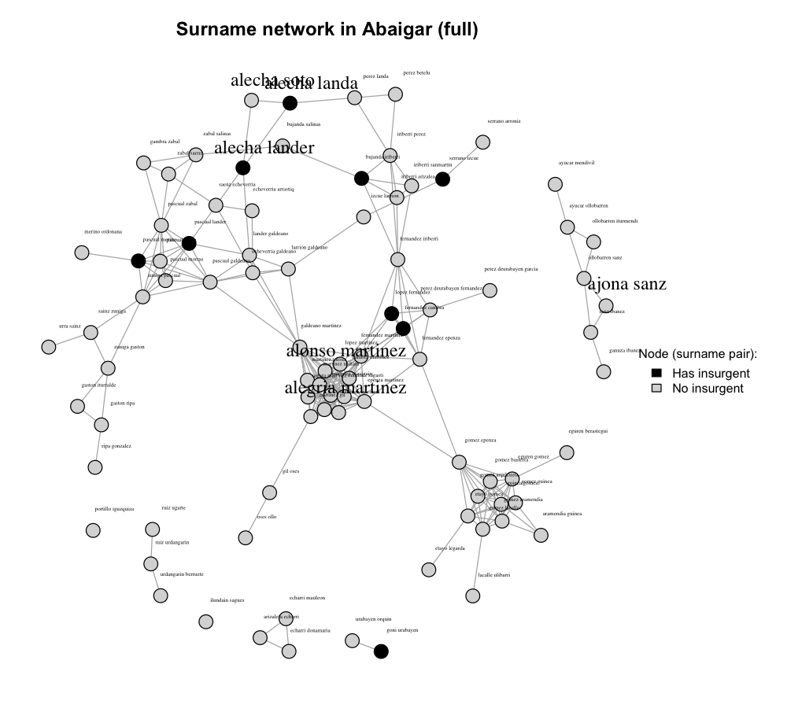

::: {.back-nav}
[<i class="fa-solid fa-arrow-left"></i> Back to Projects](../projects.qmd)
:::

::: {.project-detail-meta}
- **Collaborator:** [Sergi Martínez](https://sergimartinez.github.io/){target="_blank"}
- **Topics:** Social networks, political violence, civil war
- **Status:** In Progress
:::

## Overview

In this project, a joint work with [Sergi Martínez](https://sergimartinez.github.io/){target="_blank"}, we investigate how an individual's position within social networks influences their decision to participate in an insurgency. Does social proximity to ideologically committed individuals or local community leaders shape incentives to take up arms? And how do these local social incentives interact with the coercive power of the state?

To answer these questions, we focus on pro-Franco mobilization in the province of Navarre during the Spanish Civil War (1936&ndash;1939). We undertook a major archival digitization effort to reconstruct pre-war social and political networks across every village and municipality in the province, encompassing the entire voting-age population (both insurgents and non-insurgents).

Follow-up projects explore the relationship between network position and wartime victimization.

## Archival Data & Digitization

The empirical foundation of the project rests on newly assembled, individual-level microdata drawn from untapped provincial archives:

- **Pro-Franco combatant database:** Complete individual records of combatants in pro-Franco factions, including paramilitary organizations (such as Carlist *Requetés* and *Falange Española*) and regular units of the Spanish Army.
- **Pre-war electoral census (1934):** The complete electoral census of Navarre, providing exhaustive socio-demographic and geographic coverage of all voting-age citizens.
- **Conservative elites & political clubs:** Newly digitized membership registers from pre-war conservative and Catholic associations, capturing local leadership networks.
- **Rosters of Republican militants:** Individual records of left-wing and Republican party affiliates and trade union members.
- **Repression and victimization records:** Comprehensive victim-level data documenting Francoist wartime and post-war political repression.
- **Polling station tallies:** Station-level vote returns capturing turnout and voting behavior in the decisive February 1936 general election.

## Network Reconstruction

The image below illustrates the reconstructed pre-war social and kinship network for the municipality of Abáigar (Navarre), mapping ties among residents and their subsequent mobilization trajectories during the conflict.

::: {.my-4}

:::

## Presentations & Materials

  <a href="https://giacomolemoli.github.io/uploads/slides/navarra-1936/20260615_SPEIN.html" class="btn btn-outline-primary btn-sm" target="_blank"><i class="fa-solid fa-display"></i> Work-in-Progress Slides (SPEIN Conference 2026)</a>

## Related Work

::: {.pub-entry}
**Networks and Dynamics of Violent Political Mobilization: Historical Evidence from Spain**

Giacomo Lemoli and Sergi Martínez
:::
